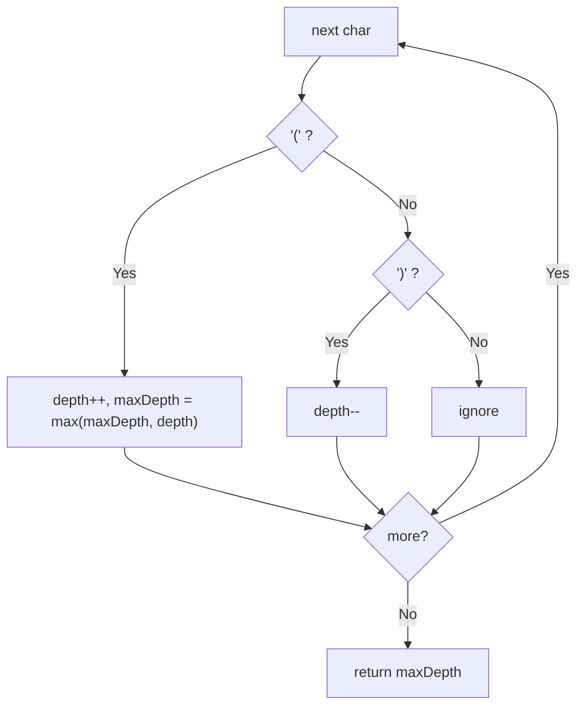

# 1614. Maximum Nesting Depth of the Parentheses

🟢 **Easy** · Stacks / Strings · [Problem on LeetCode](https://leetcode.com/problems/maximum-nesting-depth-of-the-parentheses/)

## 📝 Problem
Given a **valid** parentheses string (it may also contain digits and operators), return the maximum nesting depth.

## 🧠 Intuition
A stack would work, but we only ever need **how many** `(` are currently open. A counter is enough:
- `(` → depth + 1 (check the max)
- `)` → depth − 1

## 🪜 Approach
1. `depth = 0`, `maxDepth = 0`.
2. For each char: update `depth` as above; `maxDepth = max(maxDepth, depth)` after each `(`.
3. Return `maxDepth`.

## 🔁 Flow

## 🔍 Dry run
`s = "(1+(2*3)+((8)/4))+1"`
depth goes `1, 2, 1, 2, 3, 2, 1, 0` → max **3** ✅

## ⏱️ Complexity
| | |
|---|---|
| Time | `O(n)` |
| Space | `O(1)` |

## 💡 Key takeaway
When you only need the stack's **size**, replace the stack with a **counter**.
