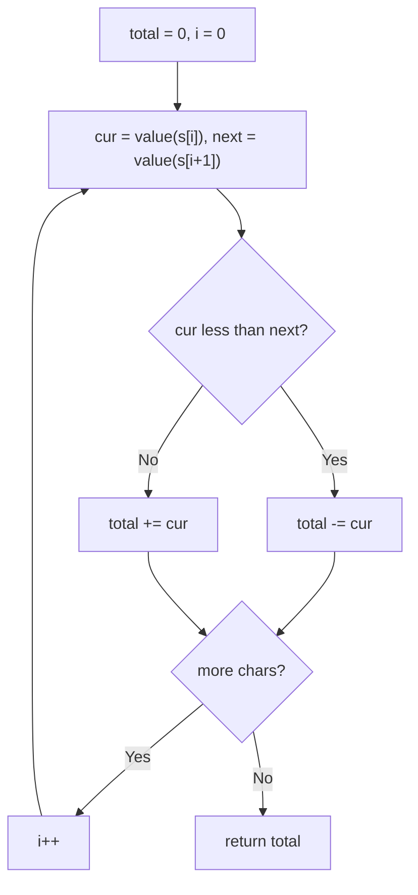

# 13. Roman to Integer

🟢 **Easy** · Strings / Hashing · [Problem on LeetCode](https://leetcode.com/problems/roman-to-integer/)

## 📝 Problem
Convert a Roman numeral string (`I V X L C D M`) to an integer.

## 🧠 Intuition
Roman numerals are usually written **largest to smallest**, and we just add.
The special cases (`IV = 4`, `IX = 9`, `XL = 40`, `XC = 90`, `CD = 400`, `CM = 900`) all have a **smaller symbol before a larger one**, which means *subtract the smaller one*.

So: **if the current value < the next value, subtract it; otherwise add it.**

## 🪜 Approach
1. For each index `i`:
   - `cur = value(s[i])`, `next = value(s[i+1])` (0 if none)
   - `cur < next` → `total -= cur`, else `total += cur`
2. Return `total`.

## 🔁 Flow

## 🔍 Dry run
`s = "MCMXCIV"`

| char | cur | next | action | total |
|:-:|:-:|:-:|:-:|:-:|
| M | 1000 | 100 | + | 1000 |
| C | 100 | 1000 | − | 900 |
| M | 1000 | 10 | + | 1900 |
| X | 10 | 100 | − | 1890 |
| C | 100 | 1 | + | 1990 |
| I | 1 | 5 | − | 1989 |
| V | 5 | 0 | + | **1994** ✅ |

## ⏱️ Complexity
| | |
|---|---|
| Time | `O(n)` |
| Space | `O(1)` |

## 💡 Key takeaway
Look one step ahead: a rule that depends on the **next element** can often be handled in a single pass.
