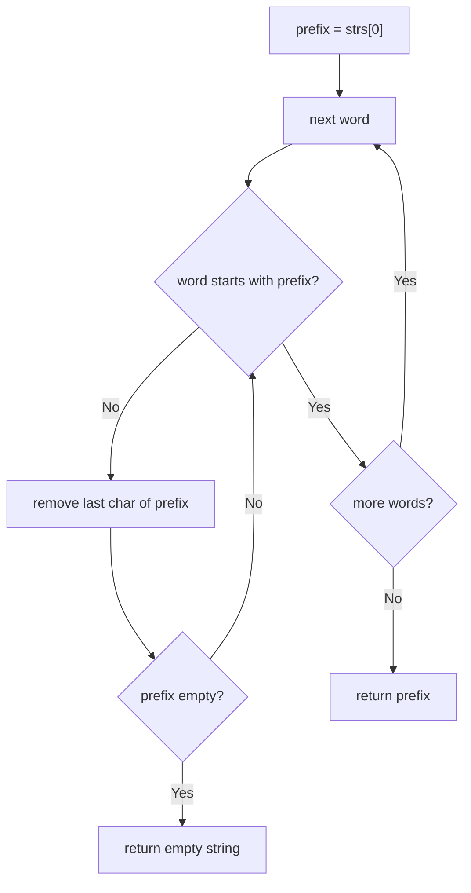

# 14. Longest Common Prefix

🟢 **Easy** · Strings · [Problem on LeetCode](https://leetcode.com/problems/longest-common-prefix/)

## 📝 Problem
Return the longest string that is a prefix of **every** word in `strs`. Return `""` if there is none.

## 🧠 Intuition
The common prefix can't be longer than the first word. So assume the **first word is the prefix** and keep **trimming its end** until every other word starts with it.

## 🪜 Approach
1. `prefix = strs[0]`.
2. For each other word: while it doesn't start with `prefix`, remove the last character of `prefix`. If `prefix` becomes empty → return `""`.
3. Return `prefix`.

*(Alternative: vertical scanning, comparing character `j` of all words column by column.)*

## 🔁 Flow

## 🔍 Dry run
`strs = ["flower", "flow", "flight"]`
- prefix = `flower`
- vs `flow`: flower → flowe → **flow** ✅
- vs `flight`: flow → flo → **fl** ✅

Answer: **"fl"**

## ⏱️ Complexity
| | |
|---|---|
| Time | `O(S)`, where S is the total number of characters |
| Space | `O(1)` extra |

## 💡 Key takeaway
Start with the **largest possible answer** and shrink it until it's valid.
