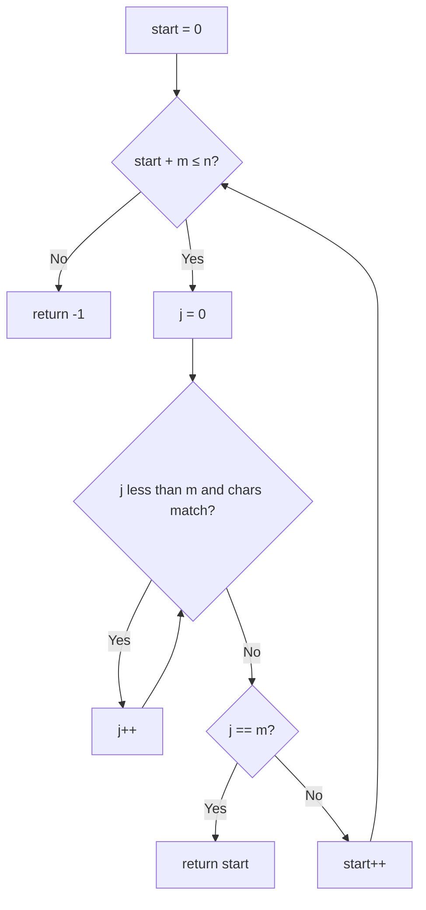

# 28. Find the Index of the First Occurrence in a String

🟢 **Easy** · Strings / Two Pointers · [Problem on LeetCode](https://leetcode.com/problems/find-the-index-of-the-first-occurrence-in-a-string/)

## 📝 Problem
Return the index of the first occurrence of `needle` in `haystack`, or `-1` if it isn't there.

## 🧠 Intuition
`needle` can start at any index `start` where it still fits (`start + m ≤ n`). At each start, compare characters one by one; the first full match wins.

## 🪜 Approach
1. For `start = 0 … n − m`:
   - `j = 0`; while `j < m` and the characters match → `j++`
   - if `j == m` → return `start`
2. Return `-1`.

> 🚀 **Advanced:** the **KMP** algorithm does this in `O(n + m)` by never re-checking characters, using a precomputed "longest prefix that is also a suffix" table.

## 🔁 Flow

## 🔍 Dry run
`haystack = "sadbutsad"`, `needle = "sad"`
- start 0: `s a d` all match → **0** ✅

`haystack = "leetcode"`, `needle = "leeto"` → no window matches → **-1**

## ⏱️ Complexity
| | |
|---|---|
| Time | `O(n · m)` worst case (`O(n + m)` with KMP) |
| Space | `O(1)` |

## 💡 Key takeaway
Substring search = **sliding window + compare**. Learn KMP once you're comfortable.
