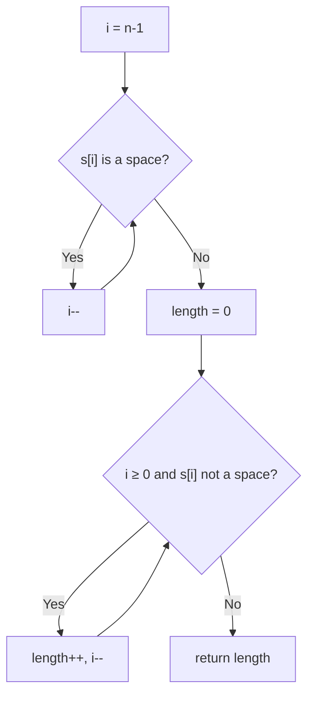

# 58. Length of Last Word

🟢 **Easy** · Strings · [Problem on LeetCode](https://leetcode.com/problems/length-of-last-word/)

## 📝 Problem
Return the length of the **last word** in `s` (words are separated by spaces; there may be trailing spaces).

## 🧠 Intuition
The last word is at the end, so start from the **end**. First skip any trailing spaces, then count characters until you hit a space.

## 🪜 Approach
1. `i = n - 1`; while `s[i] == ' '` → `i--`.
2. While `i ≥ 0` and `s[i] != ' '` → `length++`, `i--`.
3. Return `length`.

## 🔁 Flow

## 🔍 Dry run
`s = "   fly me   to   the moon  "`
- skip 2 trailing spaces → at `n`
- count `n, o, o, m` → **4** ✅

## ⏱️ Complexity
| | |
|---|---|
| Time | `O(n)` worst case, but usually only touches the end |
| Space | `O(1)` |

## 💡 Key takeaway
If the answer lives at the end, **scan backwards** instead of splitting the whole string.
