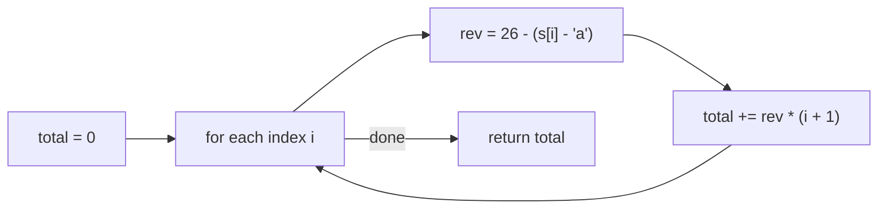

# 3498. Reverse Degree of a String

🟢 **Easy** · Strings / Simulation · [Problem on LeetCode](https://leetcode.com/problems/reverse-degree-of-a-string/)

## 📝 Problem
For each character, multiply its position in the **reversed alphabet** (`'a' = 26, 'b' = 25, …, 'z' = 1`) by its **1-indexed** position in the string. Return the sum.

## 🧠 Intuition
`c - 'a'` gives a letter's normal 0-based index (`a → 0`, `z → 25`).
Reversed value = `26 − (c − 'a')`. After that it's a straight sum.

## 🪜 Approach
1. `total = 0`.
2. For `i = 0 … n-1`: `total += (26 − (s[i] − 'a')) × (i + 1)`.
3. Return `total`.

## 🔁 Flow

## 🔍 Dry run
`s = "abc"`
- `a`: 26 × 1 = 26
- `b`: 25 × 2 = 50
- `c`: 24 × 3 = 72

Total = **148** ✅

## ⏱️ Complexity
| | |
|---|---|
| Time | `O(n)` |
| Space | `O(1)` |

## 💡 Key takeaway
`c - 'a'` converts a letter to a number: the most common character trick in Java.
