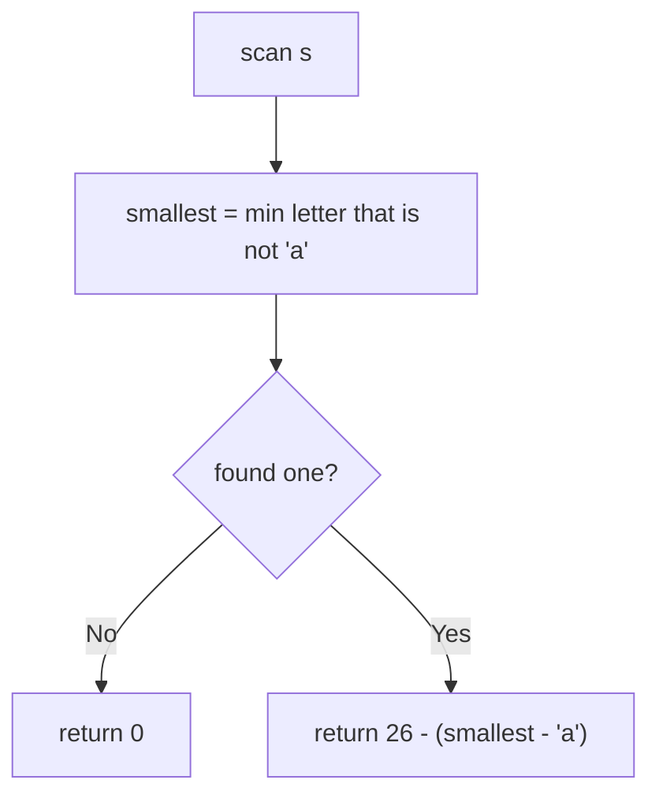

# 3675. Minimum Operations to Transform String

🟡 **Medium** · Strings / Greedy · [Problem on LeetCode](https://leetcode.com/problems/minimum-operations-to-transform-string/)

## 📝 Problem
In one operation you choose a letter `c` and replace **every** occurrence of `c` with the next letter (`'z'` wraps to `'a'`). Return the minimum number of operations to turn the whole string into `'a'`s.

## 🧠 Intuition
Letters only move **forward**, so a letter `c` needs `26 − (c − 'a')` steps to wrap around to `'a'`.
The **smallest** non-`'a'` letter is the farthest from `'a'`. While it marches forward, it reaches every larger letter in the string. Once they become the same letter, one operation moves them all together.

So everything is finished when the smallest letter arrives: **answer = 26 − (smallest − 'a')**.

## 🪜 Approach
1. Find the smallest character that isn't `'a'`.
2. If none → return `0`.
3. Return `26 − (smallest − 'a')`.

## 🔁 Flow

## 🔍 Dry run
`s = "yz"`
- smallest non-a = `y` (index 24) → `26 − 24 = 2`
- Check: `y → z` (now "zz"), `z → a` (now "aa") → **2** ✅

`s = "a"` → **0**

## ⏱️ Complexity
| | |
|---|---|
| Time | `O(n)` |
| Space | `O(1)` |

## 💡 Key takeaway
When operations **merge** groups, find the single element that takes the longest. Everything else rides along.
