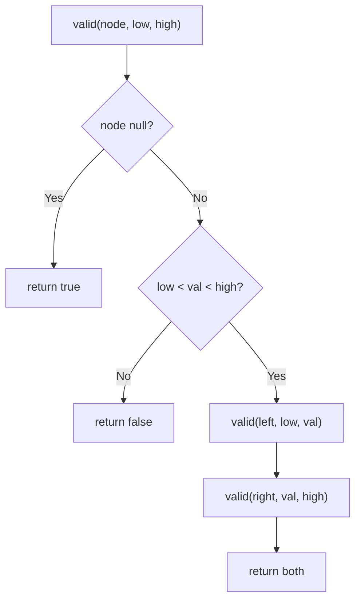

# 98. Validate Binary Search Tree

🟡 **Medium** · Trees / BST / DFS · [Problem on LeetCode](https://leetcode.com/problems/validate-binary-search-tree/)

## 📝 Problem
Given the `root` of a binary tree, return `true` if it is a valid **binary search tree**:
- every value in a node's **left** subtree is **strictly less** than the node's value,
- every value in its **right** subtree is **strictly greater**,
- and both subtrees are BSTs too.

## 🧠 Intuition
The tempting check is "`left.val < node.val < right.val` at every node". That's **wrong**:

```
    5
   / \
  4   6
     / \
    3   7      ← 3 < 6 is fine locally, but 3 is in 5's RIGHT subtree, so 3 must be > 5 ❌
```

A node isn't only compared with its parent. **Every ancestor** puts a limit on it:
- step **left** from a node → that node's value becomes the new **upper** bound
- step **right** → it becomes the new **lower** bound

So each node must sit inside a window `(low, high)` that we carry down the tree.

## 🪜 Approach
1. Start at the root with the window `(-∞, +∞)`.
2. `valid(node, low, high)`:
   - `null` → `true`
   - if `node.val <= low` or `node.val >= high` → `false` (strict, so duplicates fail)
   - recurse: `valid(left, low, node.val)` **and** `valid(right, node.val, high)`
3. Use `long` for the bounds, so a node whose value is `Integer.MIN_VALUE` or `Integer.MAX_VALUE` isn't wrongly rejected.

## 🔁 Flow


## 🔍 Dry run
Tree `[5, 4, 6, null, null, 3, 7]`:

| Node | Window | Inside? |
|:-:|:-:|:-:|
| 5 | (-∞, +∞) | ✅ |
| 4 | (-∞, 5) | ✅ |
| 6 | (5, +∞) | ✅ |
| 3 | (5, 6) | ❌ 3 ≤ 5 → **false** |

Tree `[2, 1, 3]`: 2 in (-∞, +∞) ✅, 1 in (-∞, 2) ✅, 3 in (2, +∞) ✅ → **true** ✅

## 🪤 Traps
- **Only comparing with children** misses violations from grandparents (see the example above).
- **`<=` vs `<`**: a BST here has no duplicates, so `[2, 2, 2]` is **not** valid.
- **`int` bounds**: starting with `Integer.MIN_VALUE` as the lower bound rejects a real node with that value. `long` (or `null` for "no bound") fixes it.

## 🌱 Another way
An **inorder traversal** of a BST visits values in **strictly increasing** order. Walk inorder, remember the previous value, and fail as soon as `current <= previous`. Same `O(n)` time and `O(h)` space.

## ⏱️ Complexity
| | |
|---|---|
| Time | `O(n)` |
| Space | `O(h)` |

## 💡 Key takeaway
BST rules are about **whole subtrees**, not just children → pass a **(low, high) window** down the recursion and tighten it at every step.
