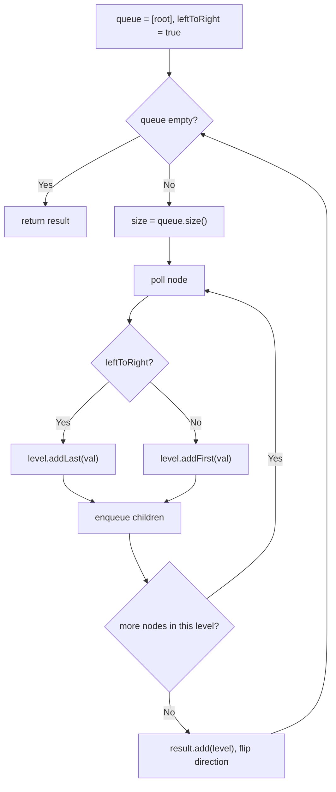

# 103. Binary Tree Zigzag Level Order Traversal

🟡 **Medium** · Trees / BFS · [Problem on LeetCode](https://leetcode.com/problems/binary-tree-zigzag-level-order-traversal/)

## 📝 Problem
Return the level-order traversal of a binary tree, but **alternate direction** each level: left→right, then right→left, and so on.

## 🧠 Intuition
This is a normal **BFS level by level**. The only change is *how we write each level*:
- even levels: append to the **end**
- odd levels: insert at the **front** (which reverses the order)

A `LinkedList` gives O(1) `addFirst` and `addLast`.

## 🪜 Approach
1. Queue with `root`; `leftToRight = true`.
2. While the queue isn't empty:
   - `size = queue.size()` (this level's node count)
   - poll `size` nodes; `addLast` or `addFirst` their values; enqueue their children
   - add the level to the result; flip `leftToRight`

## 🔁 Flow


## 🔍 Dry run
```
    3
   / \
  9  20
     / \
    15  7
```
- Level 0 (L→R): `[3]`
- Level 1 (R→L): `[20, 9]`
- Level 2 (L→R): `[15, 7]`

Answer: **[[3],[20,9],[15,7]]** ✅

## ⏱️ Complexity
| | |
|---|---|
| Time | `O(n)` |
| Space | `O(w)`, where w is the max width |

## 💡 Key takeaway
"Level by level" → BFS with **`size = queue.size()`** to process one level at a time.
