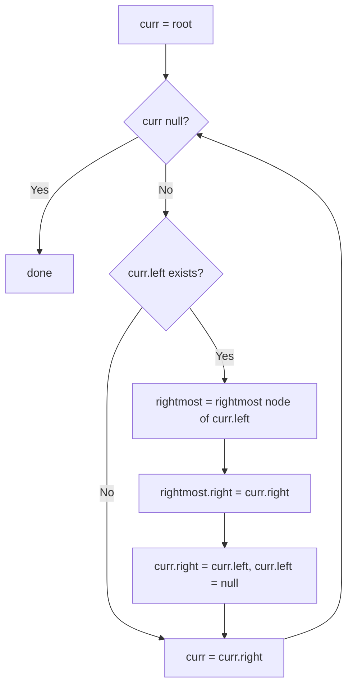

# 114. Flatten Binary Tree to Linked List

🟡 **Medium** · Trees · [Problem on LeetCode](https://leetcode.com/problems/flatten-binary-tree-to-linked-list/)

## 📝 Problem
Flatten a binary tree **in place** into a "linked list" that uses `right` pointers (all `left` pointers become `null`), in **preorder** (root, left, right).

## 🧠 Intuition
In preorder, after we finish a node's **left subtree**, we visit its **right subtree**.
The last node visited in the left subtree is its **rightmost node**. So:
1. Find the rightmost node of `curr.left`.
2. Point it to `curr.right` (the right subtree comes next).
3. Move `curr.left` over to `curr.right` and set `left = null`.
4. Step to `curr.right` and repeat.

No recursion and no stack → `O(1)` space.

## 🪜 Approach
**🐢 Simple:** collect a preorder list of nodes, then relink → `O(n)` space.
**🙂 Recursive:** flatten left and right, then splice → `O(h)` stack.
**⚡ Optimal (Morris-like):** the loop above, `O(1)` space.

## 🔁 Flow


## 🔍 Dry run
```
      1
     / \
    2   5
   / \   \
  3   4   6
```
- At 1: rightmost of left (2) is 4 → `4.right = 5`; move 2 to the right → `1 → 2(3,4) → … 4 → 5 → 6`
- At 2: rightmost of left (3) is 3 → `3.right = 4`; move → `2 → 3 → 4`
- Continue → **1 → 2 → 3 → 4 → 5 → 6** ✅

## ⏱️ Complexity
| | |
|---|---|
| Time | `O(n)` |
| Space | `O(1)` |

## 💡 Key takeaway
The **rightmost node of the left subtree** is the preorder/inorder predecessor. That's the key idea behind Morris traversal.
