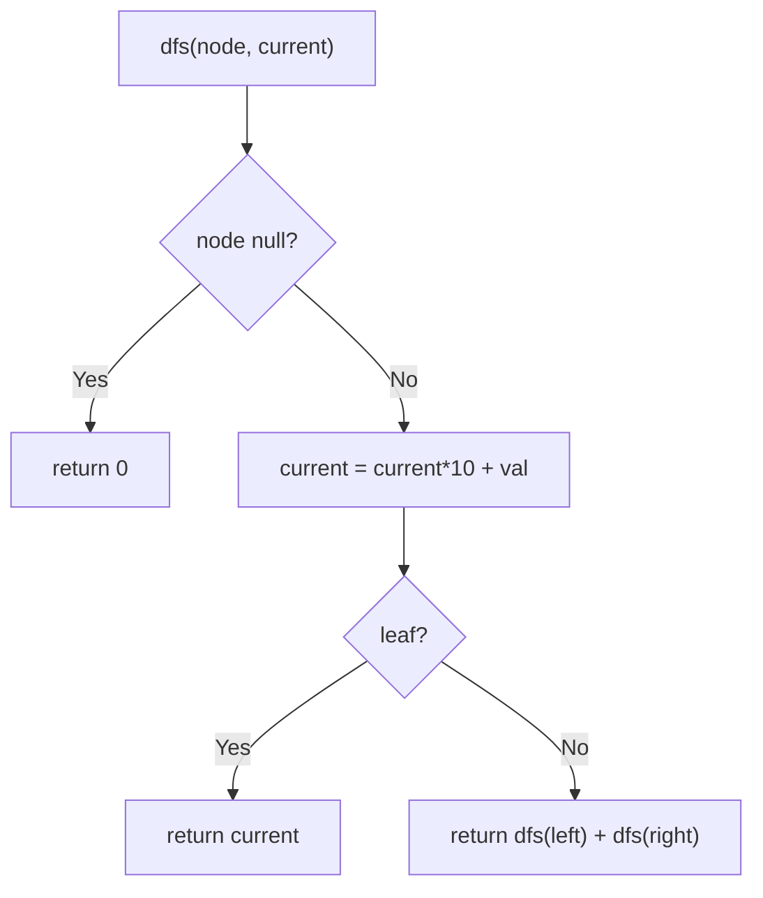

# 129. Sum Root to Leaf Numbers

🟡 **Medium** · Trees / DFS · [Problem on LeetCode](https://leetcode.com/problems/sum-root-to-leaf-numbers/)

## 📝 Problem
Each node holds a digit `0–9`. Every root-to-leaf path forms a number (e.g. `1 → 2 → 3` = `123`). Return the sum of all these numbers.

## 🧠 Intuition
Going one level down appends a digit: `current = current × 10 + node.val`.
Pass `current` down with DFS. When we hit a **leaf**, the number is complete, so return it. Each parent adds up what its children return.

## 🪜 Approach
1. `dfs(node, current)`:
   - `null` → 0
   - `current = current*10 + node.val`
   - leaf → return `current`
   - else → `dfs(left, current) + dfs(right, current)`
2. Answer = `dfs(root, 0)`.

## 🔁 Flow


## 🔍 Dry run
```
    4
   / \
  9   0
 / \
5   1
```
Paths: `495`, `491`, `40` → 495 + 491 + 40 = **1026** ✅

## ⏱️ Complexity
| | |
|---|---|
| Time | `O(n)` |
| Space | `O(h)` |

## 💡 Key takeaway
Path-based tree problems → **DFS carrying state down** (here, the number built so far).
