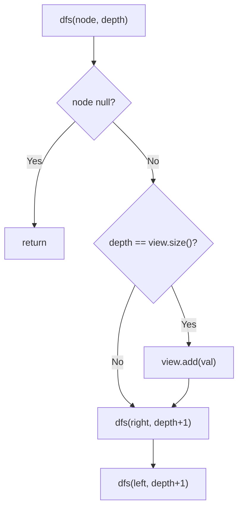

# 199. Binary Tree Right Side View

🟡 **Medium** · Trees / DFS · [Problem on LeetCode](https://leetcode.com/problems/binary-tree-right-side-view/)

## 📝 Problem
Imagine standing to the right of a binary tree. Return the values you can see, from top to bottom.

## 🧠 Intuition
You see **one node per level**: the **rightmost** one.
- **BFS:** take the last node of each level.
- **DFS (used here):** go **right before left**. The **first** node we reach at each new depth is the rightmost one. `depth == view.size()` means "first time at this depth".

## 🪜 Approach
1. `dfs(node, depth)`:
   - `null` → return
   - if `depth == view.size()` → `view.add(node.val)`
   - `dfs(right, depth+1)`, then `dfs(left, depth+1)`

## 🔁 Flow


## 🔍 Dry run
```
    1
   / \
  2   3
   \   \
    5   4
```
DFS order (right first): 1 (d0 ✅), 3 (d1 ✅), 4 (d2 ✅), 2 (d1 ✗), 5 (d2 ✗)
Answer: **[1, 3, 4]** ✅

Left-heavy case `1 → left 2 → left 4`: right side is empty, so 2 and 4 are visible → `[1, 2, 4]`.

## ⏱️ Complexity
| | |
|---|---|
| Time | `O(n)` |
| Space | `O(h)` |

## 💡 Key takeaway
"First node seen at each depth" → DFS with **`depth == list.size()`**. Change the visiting order to choose which side you see.
