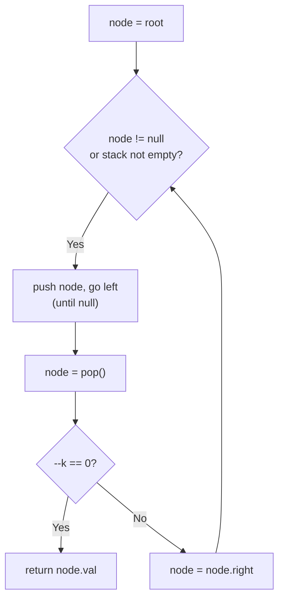

# 230. Kth Smallest Element in a BST

🟡 **Medium** · Trees / BST / Inorder · [Problem on LeetCode](https://leetcode.com/problems/kth-smallest-element-in-a-bst/)

## 📝 Problem
Given the `root` of a binary search tree and an integer `k`, return the **k-th smallest** value in the tree (1-indexed).

## 🧠 Intuition
The one fact that solves this: **inorder traversal of a BST gives the values in sorted order.**

Inorder = left subtree → node → right subtree. Everything in the left subtree is smaller and everything in the right is bigger, so the nodes come out smallest-first. Count as you go; the k-th node you visit is the answer.

Why iterative? A recursive inorder is easy, but stopping early from deep inside recursion is clumsy. With our own stack we can **return the moment we reach the k-th node**.

## 🪜 Approach
1. `node = root`, empty stack.
2. Loop while `node != null` or the stack isn't empty:
   - **Dive left:** push `node` and move to `node.left` until `null`.
   - **Visit:** `node = stack.pop()`. Decrease `k`. If `k == 0`, return `node.val`.
   - **Go right:** `node = node.right`.

## 🔁 Flow


## 🔍 Dry run
```
        5
       / \
      3   6
     / \
    2   4
   /
  1
```
`k = 3`

| Step | Action | Stack (top →) | Visited | k |
|:-:|---|---|---|:-:|
| 1 | push 5, 3, 2, 1 | 1, 2, 3, 5 | – | 3 |
| 2 | pop **1** | 2, 3, 5 | 1 | 2 |
| 3 | pop **2** | 3, 5 | 1, 2 | 1 |
| 4 | pop **3** | 5 | 1, 2, **3** | 0 → return **3** ✅ |

We never touched 4, 5's right side or 6: that's the early stop.

## 🪤 Traps
- **k is 1-indexed:** the 1st smallest is the minimum, so decrement *then* check `== 0`.
- **Don't sort a list of all values** unless you have to: it works, but it's `O(n log n)` and ignores the BST property.
- **Forgetting the right subtree:** after visiting a node, the next-larger values live in its right subtree, not back up the stack.

## 🌱 Follow-up
*What if the tree is modified often and `kthSmallest` is called many times?* Store the **size of each node's left subtree**. Then at each node: if `k == leftSize + 1` it's this node; if smaller, go left; otherwise go right with `k -= leftSize + 1`. That's `O(h)` per query.

## ⏱️ Complexity
| | |
|---|---|
| Time | `O(h + k)` |
| Space | `O(h)` |

## 💡 Key takeaway
"Sorted order" + BST → **inorder traversal**. Make it iterative with a stack when you need to **stop early**.
