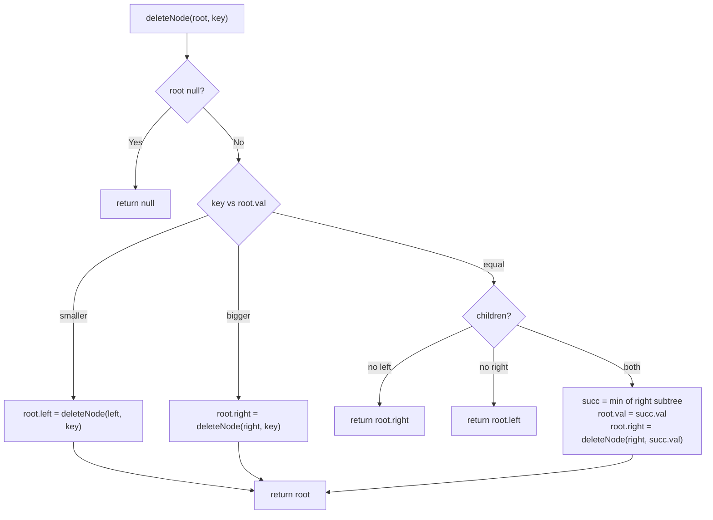

# 450. Delete Node in a BST

🟡 **Medium** · Trees / BST · [Problem on LeetCode](https://leetcode.com/problems/delete-node-in-a-bst/)

## 📝 Problem
Given the `root` of a binary search tree and a `key`, delete the node with that value (if it exists) and return the root of the tree. The result must still be a valid BST.

## 🧠 Intuition
Two parts:

1. **Find the node.** It's a BST, so walk like a binary search: smaller → go left, bigger → go right.
2. **Remove it without breaking the order.** It depends on how many children the node has:

| Children | What to do |
|:-:|---|
| 0 | Just remove it (return `null`). |
| 1 | Its only child takes its place. |
| 2 | Replace its value with the **inorder successor** (the smallest value in its right subtree), then delete that successor from the right subtree. |

Why the successor? It's **bigger than everything in the left subtree** (it came from the right) and **smaller than everything else in the right subtree** (it was the minimum there). So it fits exactly where the deleted value was. The successor has no left child, so deleting it is always the easy 0- or 1-child case.

## 🪜 Approach
`deleteNode(root, key)` returns the new root of this subtree:
1. `root == null` → return `null` (key not found).
2. `key < root.val` → `root.left = deleteNode(root.left, key)`.
3. `key > root.val` → `root.right = deleteNode(root.right, key)`.
4. Found it:
   - no left child → return `root.right`
   - no right child → return `root.left`
   - two children → find the leftmost node of `root.right`, copy its value into `root`, then `root.right = deleteNode(root.right, thatValue)`.
5. Return `root`.

Returning the new subtree root and **reassigning** `root.left` / `root.right` is what re-links the tree; no parent pointers needed.

## 🔁 Flow


## 🔍 Dry run
Delete `3` from:
```
        5
       / \
      3   6
     / \   \
    2   4   7
```
1. `3 < 5` → go left.
2. Found `3`, it has **two** children.
3. Successor = smallest in `3`'s right subtree = `4`. Copy it: the node now holds `4`.
4. Delete `4` from that right subtree (a leaf) → gone.

```
        5
       / \
      4   6
     /     \
    2       7
```
Inorder is still sorted: `2, 4, 5, 6, 7` ✅

## 🪤 Traps
- **Forgetting to reassign** `root.left = ...` / `root.right = ...`: the recursion returns the new subtree, so you must hook it back in.
- **Deleting the root itself:** works for free, because we return the new root.
- **Key not in the tree:** the search reaches `null` and nothing changes.
- **Picking the wrong replacement:** it must be the successor (min of right) or predecessor (max of left), not just any child.

## ⏱️ Complexity
| | |
|---|---|
| Time | `O(h)` |
| Space | `O(h)` |

`h` is the tree height: `O(log n)` when balanced, `O(n)` in the worst case (a chain).

## 💡 Key takeaway
Deleting from a BST = **find it, then fix the hole**: 0/1 child → splice the child up; 2 children → swap in the **inorder successor** and delete that instead.
