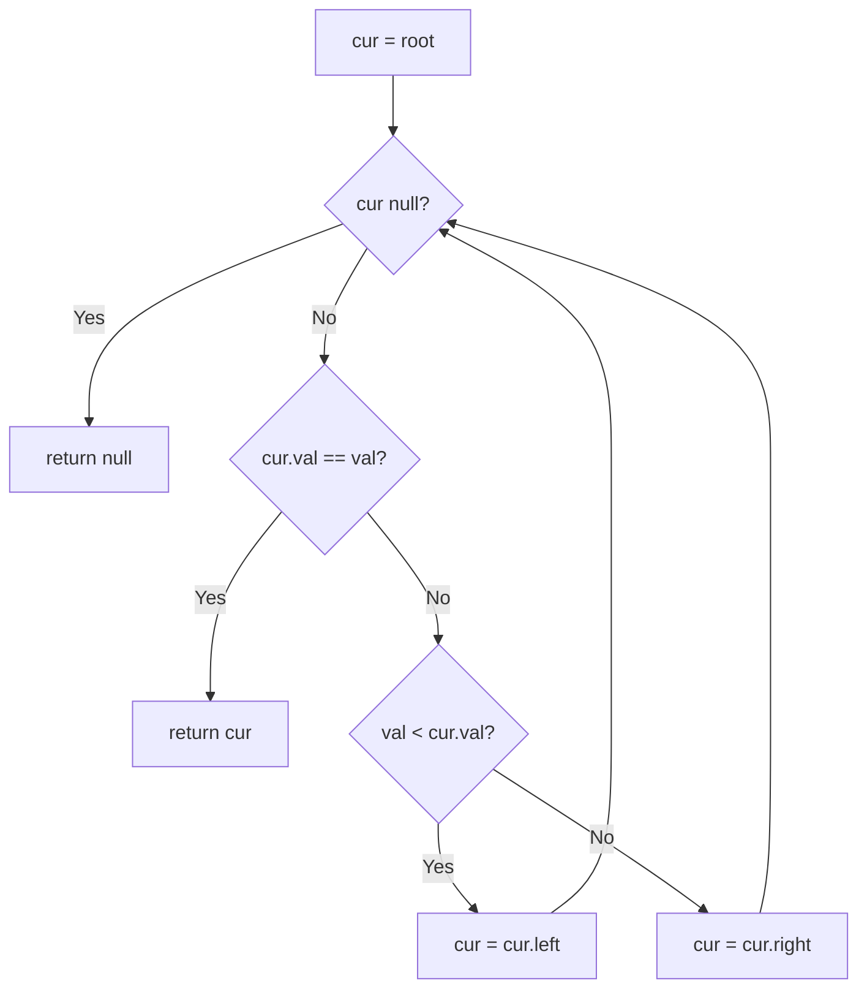

# 700. Search in a Binary Search Tree

🟢 **Easy** · Trees / BST · [Problem on LeetCode](https://leetcode.com/problems/search-in-a-binary-search-tree/)

## 📝 Problem
Given the `root` of a binary search tree and a value `val`, return the node whose value is `val` (the subtree rooted there). If it doesn't exist, return `null`.

## 🧠 Intuition
In a plain binary tree you'd have to look everywhere. A BST tells you **which way to go** at every node:
- `val` smaller than the node → it can only be on the **left**
- `val` bigger → it can only be on the **right**

So you follow **one path** down, throwing away a whole subtree at every step. It's binary search, shaped like a tree.

## 🪜 Approach
1. `cur = root`.
2. While `cur` isn't `null` and `cur.val != val`: move to `cur.left` if `val` is smaller, otherwise `cur.right`.
3. Return `cur`: the match, or `null` if we fell off the tree.

## 🔁 Flow


## 🔍 Dry run
Search `2` in:
```
      4
     / \
    2   7
   / \
  1   3
```
| At | Compare | Move |
|:-:|---|---|
| 4 | 2 < 4 | left |
| 2 | found ✅ | return the subtree `[2, 1, 3]` |

Search `5`: 4 → right (7) → left (empty) → `null`.

## 🪤 Traps
- **Searching both sides:** works, but it's `O(n)` and ignores the BST property.
- **Returning the value instead of the node:** the problem wants the node (its subtree).
- **Empty tree:** the loop never runs and returns `null`, which is correct.

## ⏱️ Complexity
| | |
|---|---|
| Time | `O(h)` |
| Space | `O(1)` |

`h` is `O(log n)` for a balanced tree and `O(n)` for a chain.

## 💡 Key takeaway
A BST turns search into **one path**: compare, pick a side, repeat. The same walk is the first half of insert (701) and delete (450).
