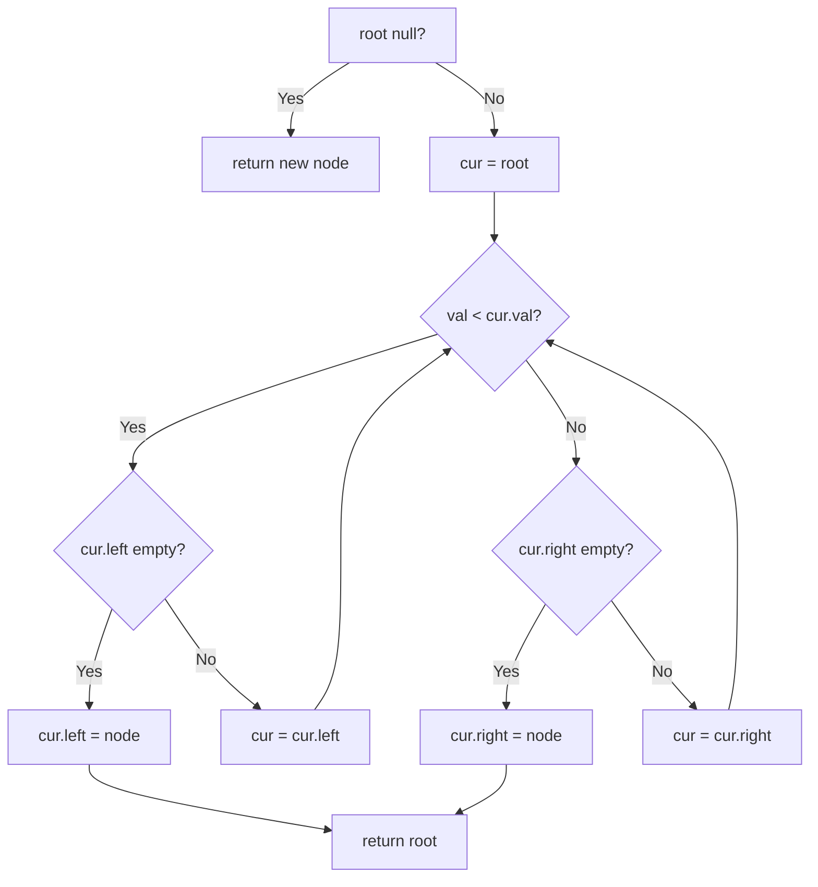

# 701. Insert into a Binary Search Tree

🟡 **Medium** · Trees / BST · [Problem on LeetCode](https://leetcode.com/problems/insert-into-a-binary-search-tree/)

## 📝 Problem
Given the `root` of a binary search tree and a value `val` that is **not** already in the tree, insert it and return the root. Any valid BST is accepted.

## 🧠 Intuition
You never have to rearrange anything: **a new value always fits as a new leaf.**

Walk down exactly like a search. At each node, `val` is either smaller (go left) or bigger (go right). Eventually you step onto an empty spot, and that spot is the one place where `val` keeps every node's left side smaller and right side bigger. Put it there.

## 🪜 Approach
1. Make the new node. If the tree is empty, it is the whole tree: return it.
2. Start at the root and loop:
   - `val < cur.val`: if `cur.left` is empty, attach the node there and stop; otherwise move left.
   - otherwise: if `cur.right` is empty, attach it there and stop; otherwise move right.
3. Return the original `root` (it never changes).

## 🔁 Flow


## 🔍 Dry run
Insert `5` into:
```
      4
     / \
    2   7
   / \
  1   3
```
| At | Compare | Move |
|:-:|---|---|
| 4 | 5 > 4 | right |
| 7 | 5 < 7, left is empty | attach here ✅ |

```
      4
     / \
    2   7
   / \  /
  1  3 5
```

## 🪤 Traps
- **Empty tree:** there's no node to attach to, so return the new node itself.
- **Losing the root:** keep `root` untouched and walk with a separate `cur`.
- **Over-thinking it:** you don't need to rebalance; LeetCode accepts any valid BST.

## 🌱 Recursive version
```java
if (root == null) return new TreeNode(val);
if (val < root.val) root.left = insertIntoBST(root.left, val);
else root.right = insertIntoBST(root.right, val);
return root;
```
Shorter, but uses `O(h)` stack space.

## ⏱️ Complexity
| | |
|---|---|
| Time | `O(h)` |
| Space | `O(1)` |

## 💡 Key takeaway
Inserting into a BST = **search until you fall off the tree, then hang the new leaf there.**
