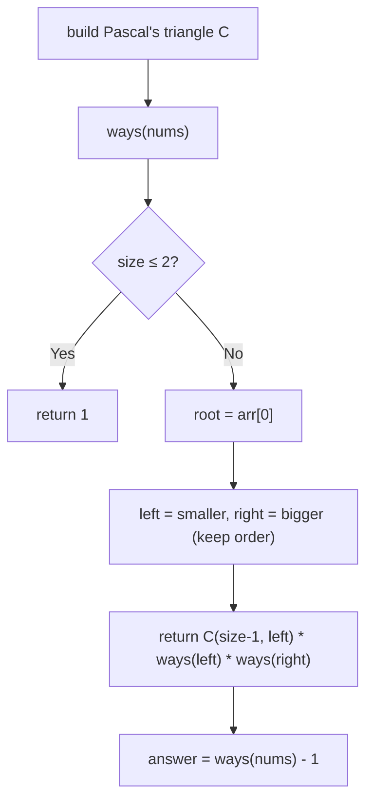

# 1569. Number of Ways to Reorder Array to Get Same BST

🔴 **Hard** · Trees / BST / Combinatorics / Divide & Conquer · [Problem on LeetCode](https://leetcode.com/problems/number-of-ways-to-reorder-array-to-get-same-bst/)

## 📝 Problem
`nums` is a permutation of `1 … n`. Inserting its elements in order into an empty BST builds a tree. Count the **other** orderings of `nums` that build the **identical** BST. Return the answer mod `10⁹ + 7`.

## 🧠 Intuition
1. The **first** element is the root, so it must always come first.
2. All remaining elements split into **left** (smaller than root) and **right** (bigger).
3. Within the left group, the relative order decides the left subtree's shape, and the same goes for the right. But a left element and a right element **never affect each other**, so the two groups can be **interleaved in any way**.

Number of ways to interleave two sequences of lengths `L` and `R` (keeping each one's internal order) = **C(L + R, L)**.

So, recursively:
```
ways(arr) = C(n − 1, L) × ways(left) × ways(right)
```
Answer = `ways(nums) − 1` (don't count the original ordering).

## 🪜 Approach
1. Precompute **Pascal's triangle** `C[i][j]` mod `10⁹+7` (no division or modular inverse needed).
2. `ways(arr)`:
   - size ≤ 2 → `1`
   - split `arr[1:]` into `left` (< root) and `right` (> root), keeping order
   - return `C[size−1][left.size] × ways(left) × ways(right)` (mod at every multiplication)
3. Return `(ways(nums) − 1 + MOD) % MOD`.

## 🔁 Flow


## 🔍 Dry run
`nums = [3, 4, 5, 1, 2]`
- root 3, left `[1, 2]`, right `[4, 5]`
- `C(4, 2) = 6`, `ways([1,2]) = 1`, `ways([4,5]) = 1`
- `ways = 6` → answer **6 − 1 = 5** ✅

`nums = [2, 1, 3]` → `C(2,1) = 2` → **1** (only `[2,3,1]`) ✅

## ⏱️ Complexity
| | |
|---|---|
| Time | `O(n²)` (Pascal's triangle + list splitting, worst case for a skewed tree) |
| Space | `O(n²)` for the triangle |

## 💡 Key takeaway
Counting orderings that keep two groups' internal order → **binomial coefficient C(L+R, L)**. Use Pascal's triangle to get binomials under a modulus without division.
