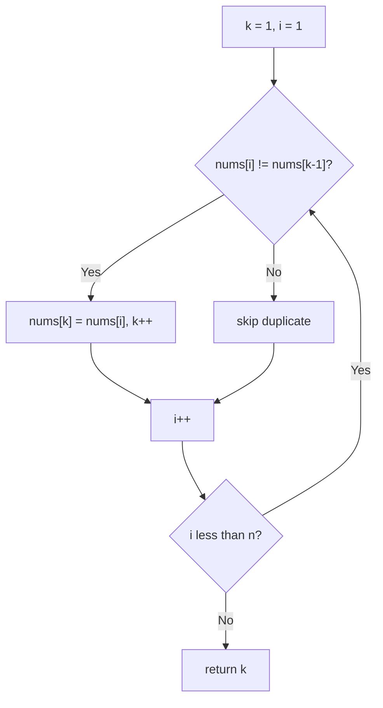

# 26. Remove Duplicates from Sorted Array

🟢 **Easy** · Two Pointers · [Problem on LeetCode](https://leetcode.com/problems/remove-duplicates-from-sorted-array/)

## 📝 Problem
`nums` is sorted in non-decreasing order. Remove duplicates **in place** so each unique element appears once, keeping the original order. Return `k`, the number of unique elements; the first `k` slots must hold them.

## 🧠 Intuition
Sorted means duplicates are **neighbours**. Use two pointers:
- `k` (slow): the next position to write a unique value
- `i` (fast): scans every element

If `nums[i]` differs from the last kept value `nums[k-1]`, it's new, so write it at `k`.

## 🪜 Approach
1. `k = 1` (the first element is always unique).
2. For `i = 1 … n-1`: if `nums[i] != nums[k-1]` → `nums[k++] = nums[i]`.
3. Return `k`.

## 🔁 Flow

## 🔍 Dry run
`nums = [0,0,1,1,1,2,2,3,3,4]`

The fast pointer finds new values `1, 2, 3, 4` and writes them at k = 1, 2, 3, 4 →
`[0,1,2,3,4, …]`, **k = 5** ✅

## ⏱️ Complexity
| | |
|---|---|
| Time | `O(n)` |
| Space | `O(1)` |

## 💡 Key takeaway
In-place filtering → **slow write pointer + fast read pointer**.
