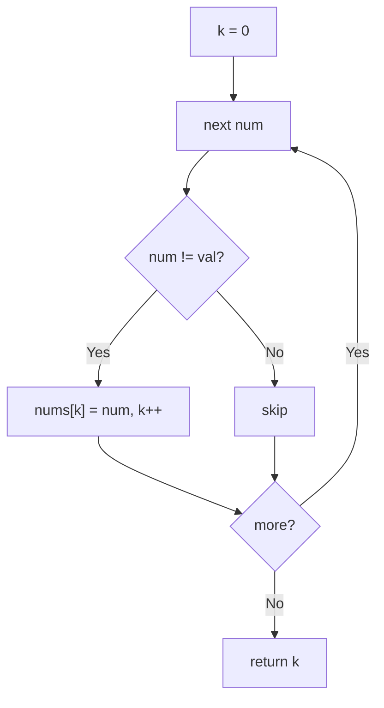

# 27. Remove Element

🟢 **Easy** · Two Pointers · [Problem on LeetCode](https://leetcode.com/problems/remove-element/)

## 📝 Problem
Remove all occurrences of `val` from `nums` **in place**. Return `k`, the count of elements not equal to `val`; those must be in the first `k` slots (any order).

## 🧠 Intuition
Instead of "deleting" (which would mean shifting everything), **keep** the good elements by copying them forward. A write pointer `k` marks the end of the kept part.

## 🪜 Approach
1. `k = 0`.
2. For each `num`: if `num != val` → `nums[k++] = num`.
3. Return `k`.

## 🔁 Flow

## 🔍 Dry run
`nums = [3, 2, 2, 3]`, `val = 3`
- 3 skip · 2 → nums[0]=2 · 2 → nums[1]=2 · 3 skip → **k = 2**, `[2, 2, _, _]`

## ⏱️ Complexity
| | |
|---|---|
| Time | `O(n)` |
| Space | `O(1)` |

## 💡 Key takeaway
Same pattern as #26: **read pointer scans, write pointer keeps**.
