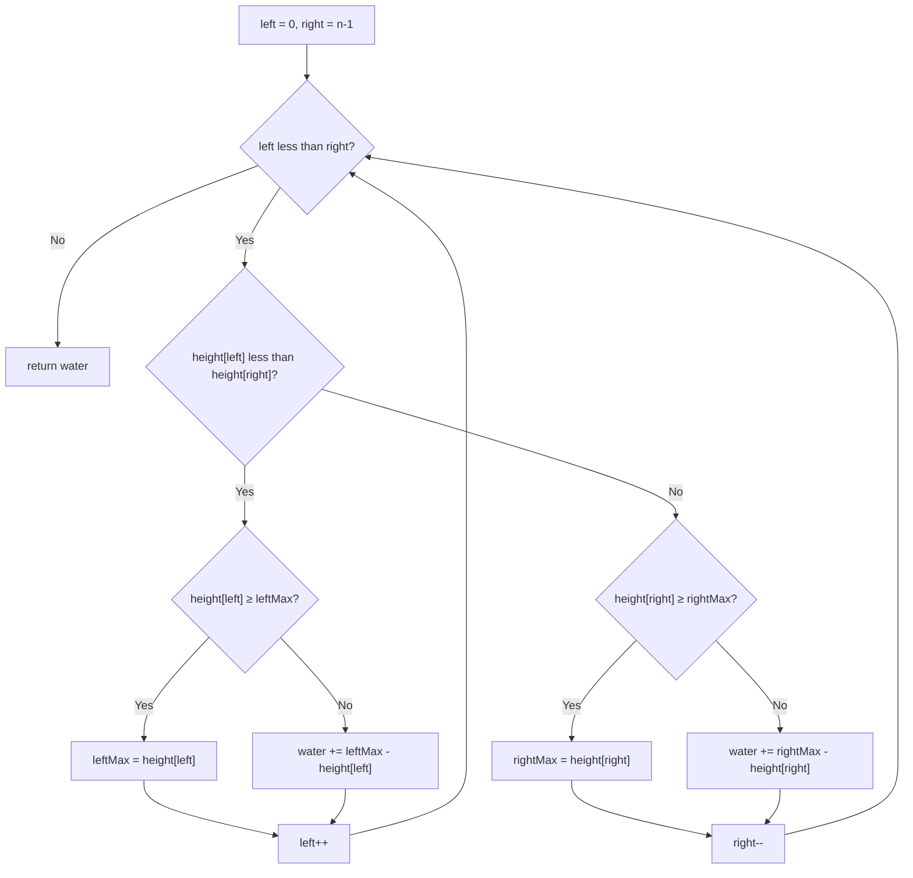

# 42. Trapping Rain Water

🔴 **Hard** · Two Pointers · [Problem on LeetCode](https://leetcode.com/problems/trapping-rain-water/)

## 📝 Problem
Given bar heights (each bar width 1), compute how much rain water is trapped between them.

## 🧠 Intuition
Look at **one bar** `i`. Water rises above it up to the **shorter** of:
- the tallest bar to its left (`leftMax`)
- the tallest bar to its right (`rightMax`)

`water[i] = min(leftMax, rightMax) − height[i]`

**Two-pointer trick:** move pointers inwards from both ends. If `height[left] < height[right]`, we know there's a wall on the right at least as tall as `height[left]`. So the **left** side's max is the bottleneck, and we can compute water at `left` without knowing the exact right max.

## 🪜 Approach
**🐢 Brute force:** for each bar scan left and right for maxes → `O(n²)`.

**🙂 Better:** precompute `leftMax[]` and `rightMax[]` arrays → `O(n)` time, `O(n)` space.

**⚡ Optimal (two pointers, O(1) space):**
1. `left = 0`, `right = n-1`, `leftMax = rightMax = 0`.
2. While `left < right`:
   - if `height[left] < height[right]`:
     - update `leftMax` or add `leftMax − height[left]` to water; `left++`
   - else do the same on the right side; `right--`
3. Return water.

## 🔁 Flow

## 🔍 Dry run
`height = [0,1,0,2,1,0,1,3,2,1,2,1]` → answer **6**

Water per bar: `[0,0,1,0,1,2,1,0,0,1,0,0]` → total 6.
E.g. bar 5 (height 0): leftMax 2, rightMax 3 → min 2 − 0 = **2** units.

## ⏱️ Complexity
| | |
|---|---|
| Time | `O(n)`: each pointer moves at most n times |
| Space | `O(1)` |

## 💡 Key takeaway
When an answer depends on `min(leftSide, rightSide)`, **two pointers from both ends** let you resolve the smaller side first.
