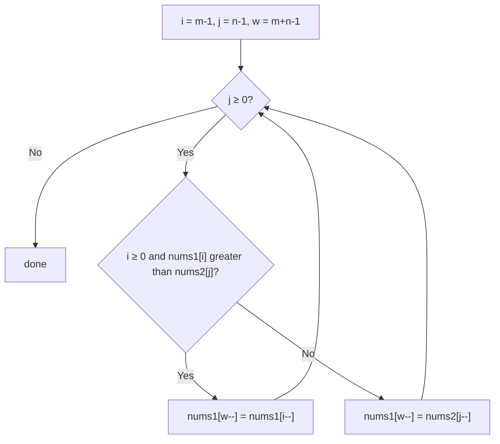

# 88. Merge Sorted Array

🟢 **Easy** · Two Pointers · [Problem on LeetCode](https://leetcode.com/problems/merge-sorted-array/)

## 📝 Problem
`nums1` (length `m + n`) holds `m` sorted numbers followed by `n` zeros. `nums2` holds `n` sorted numbers. Merge `nums2` into `nums1` **in place** so `nums1` is sorted.

## 🧠 Intuition
Merging from the **front** would overwrite `nums1` values before we use them.
But the free space is at the **back**. So merge **backwards**: compare the largest remaining of each array and put the bigger one in the last free slot.

## 🪜 Approach
1. `i = m-1`, `j = n-1`, `write = m+n-1`.
2. While `j ≥ 0`:
   - if `i ≥ 0` and `nums1[i] > nums2[j]` → `nums1[write--] = nums1[i--]`
   - else → `nums1[write--] = nums2[j--]`
3. When `nums2` is done, the leftover `nums1` elements are already in place.

## 🔁 Flow

## 🔍 Dry run
`nums1 = [1,2,3,0,0,0]`, `m = 3`, `nums2 = [2,5,6]`, `n = 3`

| compare | write | nums1 |
|---|:-:|---|
| 3 vs 6 → 6 | 5 | `[1,2,3,0,0,6]` |
| 3 vs 5 → 5 | 4 | `[1,2,3,0,5,6]` |
| 3 vs 2 → 3 | 3 | `[1,2,3,3,5,6]` |
| 2 vs 2 → 2 (nums2) | 2 | `[1,2,2,3,5,6]` |

`j < 0` → done ✅ `[1,2,2,3,5,6]`

## ⏱️ Complexity
| | |
|---|---|
| Time | `O(m + n)` |
| Space | `O(1)` |

## 💡 Key takeaway
In-place merge with spare room at the end → **fill from the back**.
