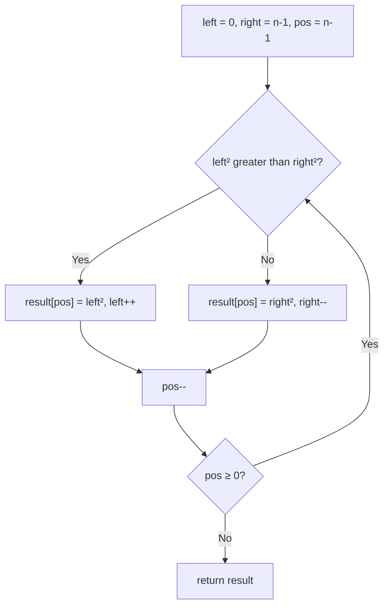

# 977. Squares of a Sorted Array

🟢 **Easy** · Two Pointers · [Problem on LeetCode](https://leetcode.com/problems/squares-of-a-sorted-array/)

## 📝 Problem
Given a sorted array (may contain negatives), return the squares of each number, **also sorted**.

## 🧠 Intuition
Squaring breaks the order because negatives become big: `[-4, -1, 0, 3]` → `[16, 1, 0, 9]`.
But the **largest** square is always at one of the **two ends**. So compare both ends, take the larger square, and fill the result **from the back**.

## 🪜 Approach
**🐢 Brute force:** square everything, then sort → `O(n log n)`.

**⚡ Optimal (two pointers):**
1. `left = 0`, `right = n-1`, `pos = n-1`.
2. Put the larger of `nums[left]²` and `nums[right]²` at `result[pos]`, move that pointer, `pos--`.
3. Repeat until `pos < 0`.

## 🔁 Flow

## 🔍 Dry run
`nums = [-4, -1, 0, 3, 10]`

| L | R | L² vs R² | placed | result |
|:-:|:-:|---|:-:|---|
| -4 | 10 | 16 vs 100 | 100 | `[_,_,_,_,100]` |
| -4 | 3 | 16 vs 9 | 16 | `[_,_,_,16,100]` |
| -1 | 3 | 1 vs 9 | 9 | `[_,_,9,16,100]` |
| -1 | 0 | 1 vs 0 | 1 | `[_,1,9,16,100]` |
| 0 | 0 | 0 vs 0 | 0 | `[0,1,9,16,100]` ✅ |

## ⏱️ Complexity
| | |
|---|---|
| Time | `O(n)` |
| Space | `O(n)` for the output |

## 💡 Key takeaway
Extremes at both ends → **two pointers from the outside in**, filling the answer from the back.
