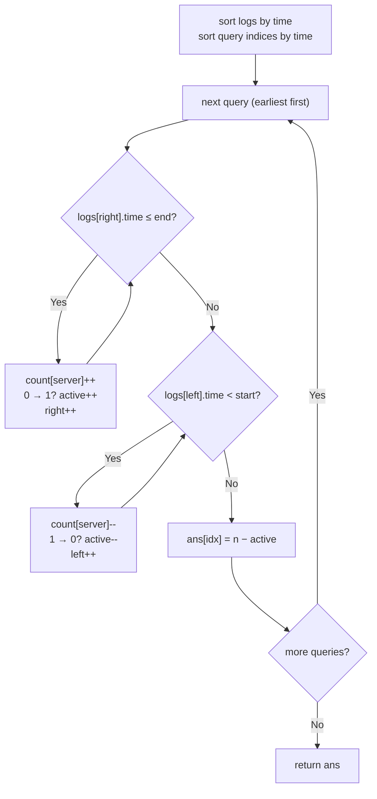

# 2747. Count Zero Request Servers

🟡 **Medium** · Two Pointers / Sliding Window · [Problem on LeetCode](https://leetcode.com/problems/count-zero-request-servers/)

## 📝 Problem
`n` servers, a list of `logs[i] = [server_id, time]` (a request hit that server at that time), a window length `x` and some `queries`. For each query `q`, count the servers that got **no** request in the inclusive window `[q - x, q]`.

## 🧠 Intuition
Answer = `n − (servers with at least one request in the window)`.

Checking every log for every query is up to `10⁵ × 10⁵` work, far too slow. But if we answer the queries **in order of time**, the window `[q − x, q]` only ever slides **forward**. So every log enters the window once and leaves once, a classic **sliding window with two pointers** over the time-sorted logs.

Inside the window we keep `count[server]` (requests per server) and `active` (servers whose count is above 0). A server with two requests in the window still counts **once**, which is why we need counts, not a yes/no flag.

## 🪜 Approach
**🐢 Brute force:** for each query, scan all logs and collect server ids in a set → `O(Q · L)`. TLE.

**⚡ Optimal (sort + sliding window):**
1. Sort `logs` by time.
2. Sort the query **indices** by query time, so each answer goes back to its original slot.
3. For each query (earliest first), with `end = q`, `start = q − x`:
   - **expand:** while `logs[right].time <= end`, add it; if that server's count goes 0 → 1, `active++`
   - **shrink:** while `logs[left].time < start`, remove it; if that server's count goes 1 → 0, `active--`
   - `ans[idx] = n − active`

## 🔁 Flow

## 🔍 Dry run
`n = 3`, `logs = [[1,3],[2,6],[1,5]]`, `x = 5`, `queries = [10,11]`

Sorted logs: `[1,3] [1,5] [2,6]`

| Query | Window | Added | Removed | Active servers | Answer |
|:-:|:-:|---|---|:-:|:-:|
| 10 | `[5, 10]` | `[1,3] [1,5] [2,6]` | `[1,3]` (3 < 5) | {1, 2} | 3 − 2 = **1** |
| 11 | `[6, 11]` | – | `[1,5]` (5 < 6) | {2} | 3 − 1 = **2** |

Output: `[1, 2]` ✅

## ⏱️ Complexity
| | |
|---|---|
| Time | `O(L log L + Q log Q)`: sorting dominates; each log is added once and removed once |
| Space | `O(n + Q)`: per-server counts and the sorted query order |

## 🪤 Traps
- The window is **inclusive** on both ends: add with `<= end`, remove with `< start`.
- Sort the query **indices**, not the queries themselves, or the answers come back in the wrong order.
- Use a **count** per server, not a boolean: a server with 2 requests must stay active until both leave the window.

## 💡 Key takeaway
Offline queries + a window that only moves forward = **sort the queries and slide two pointers**. Every element enters once and leaves once.
